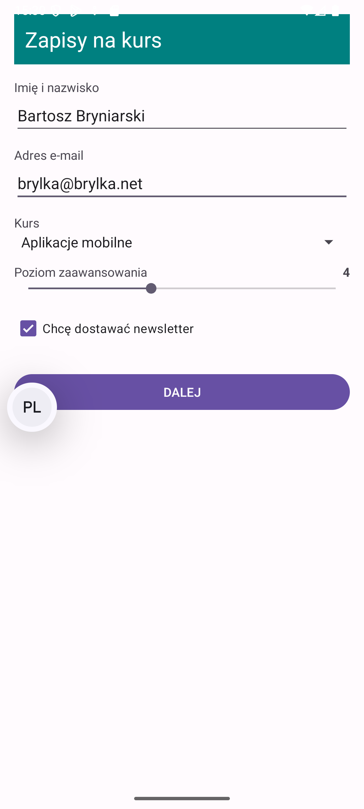
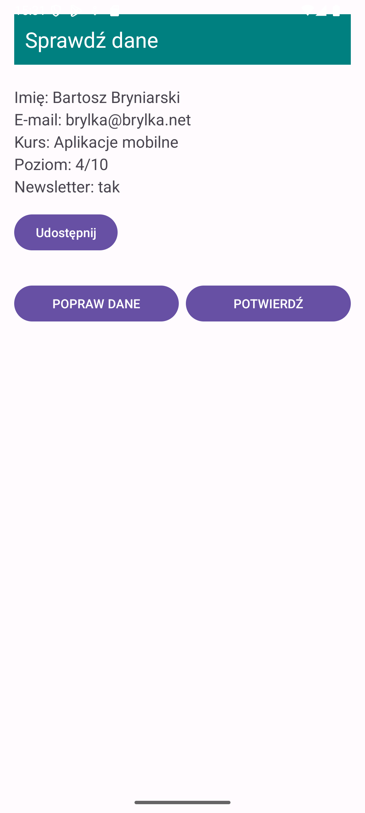

# Zadanie 1

## Zrzuty ekranu

## Odpowiedzi na pytania

**Dlaczego rejestracja wyniku jest polem klasy, a nie znajduje się w obsłudze kliknięcia przycisku?**
Ponieważ rejestracja za pomocą `registerForActivityResult` musi się odbyć, zanim ekran stanie się widoczny (tzn. zanim cykl życia osiągnie stan STARTED) – gwarantuje to poprawne obsłużenie wyniku, nawet jeśli proces aplikacji zostanie zabity i odtworzony podczas gdy drugi ekran jest na wierzchu. Wywołanie tej metody w obsłudze kliknięcia spowoduje wyrzucenie wyjątku.

**Co zobaczy ekran wywołujący, gdy użytkownik naciśnie na drugim ekranie przycisk Wstecz?**
Gdy użytkownik wciśnie przycisk Wstecz, metoda `onActivityResult` (lub jej odpowiednik w nowym API, czyli zdefiniowany lambda callback) otrzyma w obiekcie `ActivityResult` kod wyniku `RESULT_CANCELED`. W naszym kodzie nie powoduje to podjęcia żadnej akcji, więc użytkownik po prostu zobaczy z powrotem wypełniony formularz (ekran pierwszy).
